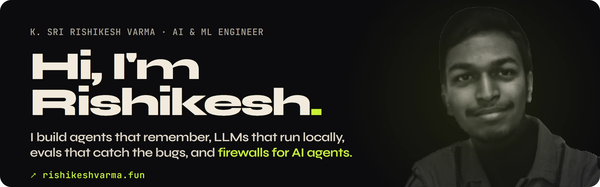
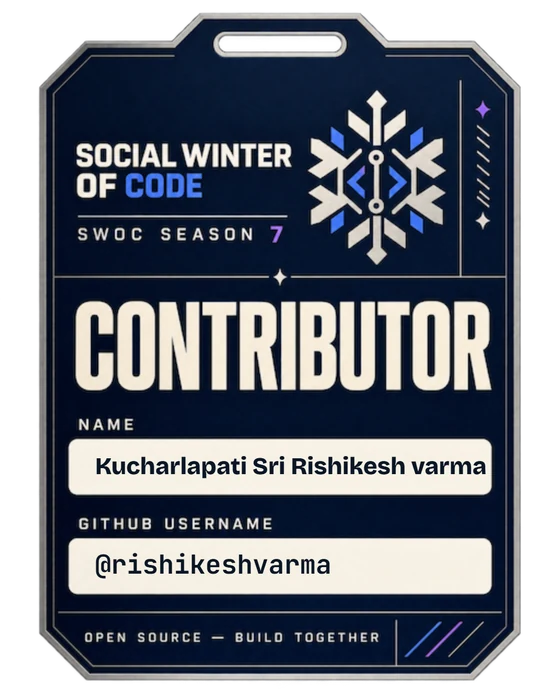

---

### 👋 About me

I'm **K. Sri Rishikesh Varma**, an AI & ML engineer and final-year **B.Tech CSE (AI & ML)** student at **KMIT, Hyderabad** (2023 – 2027). I build agentic systems in Python: tool-using agents, local LLM runtimes, multi-agent orchestration with **MCP** and **A2A**, and the eval and tracing tooling that shows whether they actually work.

- 🛡️ **Final-year project:** **MCP-Shield**, a semantic firewall for the Model Context Protocol that stops prompt-injected tool traffic before it reaches an agent.
- 🤖 **Building:** **DUM-E**, a private AI agent that runs entirely on my own GPU, at my lab **[DUM-E Labs](https://dummie-labs.github.io/.github/)**.
- 📄 **Research:** co-inventor on a published Indian patent application and author of an IEEE Xplore paper.
- 🗣️ **Exploring:** speech for Indian languages, starting with Telugu text-to-speech.
- 🎯 **Next:** GATE 2027 (DS & AI), then a Master's in AI.
- 🎾 District-level tennis runner-up · English, Telugu, learning German (A1).

---

### 🔬 Featured work

| Project | What it is | Highlights |
| :--- | :--- | :--- |
| 🛡️ **[MCP-Shield](https://github.com/rishikeshvarma/MCP-Shield)** | Inline semantic firewall for MCP traffic: policy gate → cache/signatures → fine-tuned 86M mDeBERTa-v3 on ONNX | Targets p95 < 50 ms and attack success 52.8% → < 10% *(design phase)* |
| ⚙️ **[AppCompiler](https://github.com/rishikeshvarma/APP_Compiler)** · [demo](https://app-compiler-six.vercel.app) | Self-healing LLM compiler: plain English → UI layout, REST API and PostgreSQL schema, plus an eval harness | 52 CI regression tests; the harness caught 4 bugs in the compiler |
| 🤖 **DUM-E** (Agent-Dummie) | Privacy-first personal agent on local hardware with tool calling, web search and dual memory | 27B model on a 16 GB GPU, 225K context, 4-way intent router |
| 🥷 **[PhishNinja](https://github.com/rishikeshvarma/PhishNinja-V2)** · [demo](https://phishninja-v2.vercel.app) | Multi-agent phishing defence with explainable verdicts per chat message | 99.7% precision over 1,500 trials · patent application published |
| 🗣️ **[FastSpeech 2 · English + Telugu](https://github.com/rishikeshvarma/fastspeech-2-TTS-Eng-Tel)** | Two FastSpeech 2 TTS models: Indian-accented English (Svarah) and Telugu (IndicTTS) | Technical report on data, loss curves and the variance adaptor |

---

### 📄 Patents & publications

- **Indian patent application (published, co-inventor):** *PhishNinja: An NLP-Driven Framework for Phishing and Spam Detection Using Explainable AI.* App. No. **202541111904 A**.
- **IEEE (DELCON):** [*Phishing Detection: A Comprehensive Survey of Methods and Trends*](https://ieeexplore.ieee.org/document/11400192), IEEE Xplore 11400192.

### 💼 Experience

- **Data Engineer (Remote) · Ties Verse** · Apr – Aug 2026: Python scrapers and API aggregation pipelines for news tracking; data-research workshops on geopolitical analysis.

### 🏅 Recognition

- **Social Winter of Code, Season 7:** contributor
- **Generative AI / Deep Learning Specialization:** IIT Hyderabad
- **Tech Head:** Riti Upcycling Club, KMIT

 

---

### 💻 Stack

**Languages** 

**AI, LLMs & serving** 

**Backend, data & DevOps** 

**Evals & tools** 

---

### 📊 GitHub stats

  
  

---

The full interactive version lives at <a href="https://rishikeshvarma.fun"><b>rishikeshvarma.fun</b></a>: a 3D particle portrait, a spinning project ring, and a page that never ends. Type <code>fun</code> when you get there.

